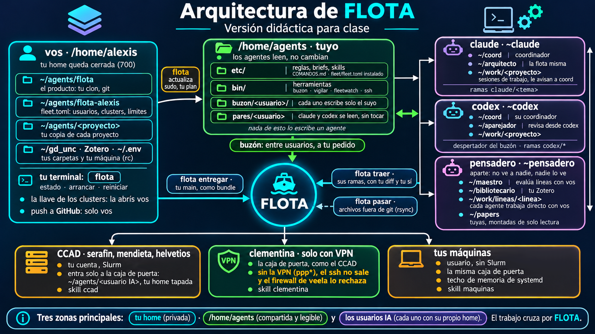

# reflotar

**RE**thinking Cameron Abrams's fleet from an **AR**gentine team.

reflotar starts from the idea of [fleet](https://github.com/cameronabrams/fleet), by
Cameron F. Abrams, and adapts it to a research group at the UNC, in Córdoba,
Argentina. It has since diverged to fit that group's own use: its machines, its HPC
clusters, and the way its members work with agents.

A fleet of AI coding agents on one Linux machine, for a research group: each AI
user is its own Linux user, the human's account is never reachable, and on HPC
clusters each AI user works inside a box of the human's account. MIT licensed; see
`LICENSE` and `NOTICE`.

reflotar is a shareable copy of `flota`, the fleet a group of the DQTC (UNC) runs
every day. It keeps the rules, the roles, the security design and the tools to build
a fleet like it, and leaves out what was particular to that group: skills to reach
its computers, memberships, its decision log (`DECISIONS.md` holds a summary), and
so on. Inside, the product is still called `flota`: clone it under that name (`git
clone https://github.com/alexispaz/reflotar flota`), and the docs, paths and the `flota` command read as
written.

A web manual in Spanish, with the same content as `docs/`:
https://claude.ai/artifact/1xZjKVMuyNvM96XE9BTaNf

Example setup: three AI users (`claude`, `codex`, `pensadero`) on two providers
(Claude Code and Codex). Each AI user is a fleet with its coordinator: claude's and
codex's coord, and the pensadero's maestro, who thinks with you and coordinates one
agent per línea, apart from everything else. The architect and the aparejador (the
architect's reviewer on codex) maintain the fleet itself. Codex is optional. The words (AI user, role session, working session, task) are in
`AGENTS.md`.

## Two repositories

- **`flota`** (this one): the product, the same for everyone. Nothing personal in it.
- **`flota-<you>`**: your configuration, one `fleet.toml` beside your clone of
  `flota`. Start it from `ejemplo-config/fleet.toml`.

Your name, user and time zone come from `fleet.toml` and fill the `{{human.*}}`
placeholders in the rules and roles when they are installed.

## Start here

In this order:

- `docs/capacidades.md`: what the fleet does, in five minutes.
- `docs/primer-dia.md`: one example from start to end.
- `docs/de-cero.md`: from zero to a running fleet, and the everyday operations.
- `docs/seguridad.md`: what protects what (Linux users, the planner, git, the
  mailbox, the sandboxes, the cluster boxes and keys), and what is not protected.
- `COMANDOS.md` (Spanish): what you can ask the fleet and run; `flota` shows it.
- `docs/herramientas.md`: the tools, one by one.
- `docs/instalacion.md`: the full recipe: install, reinstall, every later change.
- `docs/clusters.md`: giving an AI user a box on a cluster.
- `DECISIONS.md`: why things are as they are, in summary. Read it before changing anything
  structural.
- `docs/aportes.md`: sending changes back to the group, and staying up to date.

## Layout

| folder | what |
| :--- | :--- |
| `reglas/` | the conventions every working agent loads, one per provider |
| `roles/` | one brief per role (`<role>.md` for claude, `<role>-codex.md` for codex) |
| `skills/` | how-to manuals shared by the agents: one per site (`ccad`, an example) |
| `sistema/` | the planner, the installer, repository hand-over, `flota` |
| `clusters/` | the cluster box (`puerta`) and `add-cluster` |
| `herramientas/` | the fleet tools: `buzon`, `relevo`, `fleetlog`, `fleetregister`, `fleetwatch`, `fleetcontext` |
| `tmux/` | the shared tmux configuration |
| `docs/` | the guides: what it does, a first day, from zero, security, tools, installation, clusters, contributing |
| `ejemplo-config/` | the example `fleet.toml` |

Working on this repository: read `AGENTS.md`.
